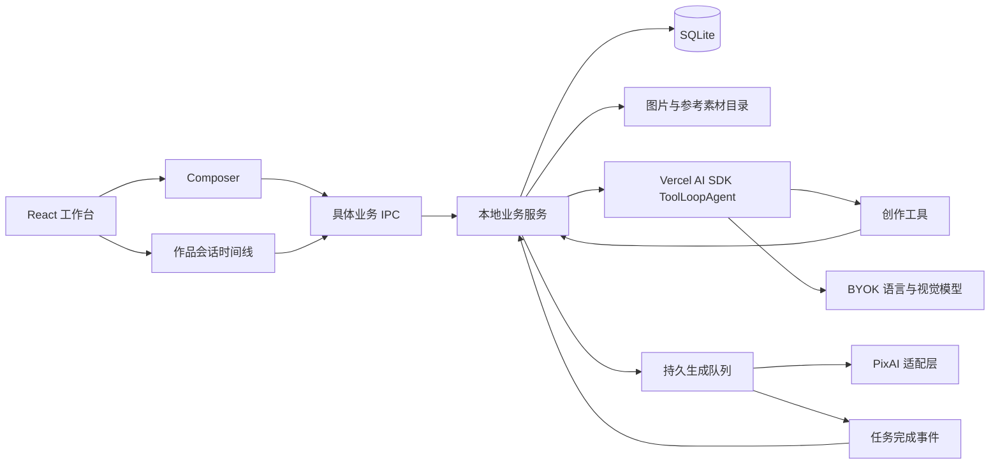
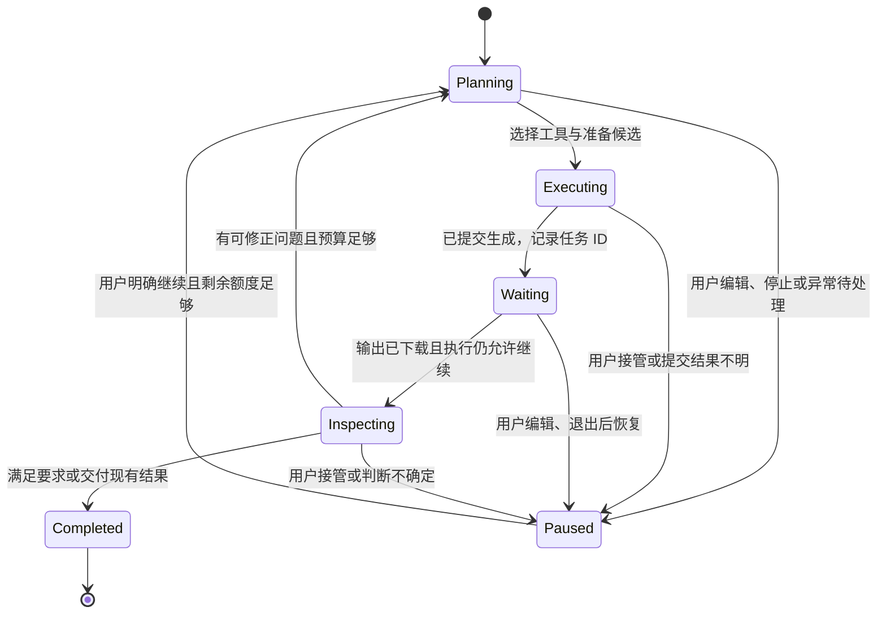

# PixAI 桌面客户端架构

状态：按已确认的架构实施，模型目录使用 REST，生成使用支持有序 Recipe ID 的 GraphQL。产品范围见 [设计说明](design.md)，术语见 [GLOSSARY](../GLOSSARY.md)。本文件描述目标架构，不代表代码已实现或接口已完成线上验证。

## 应用结构

- Electron 主进程管理窗口、进程生命周期和凭证服务。
- React 渲染层显示 Composer、作品、结果和 Agent 进度，通过 preload 暴露的具体业务方法交互。
- 一个 utility process 承载业务服务、Agent、队列与 SQLite 写入，统一管理状态。渲染层不直接连接数据库或读取凭证。
- 凭证由主进程使用 macOS 系统保护能力加密保存，按需交给执行服务；对话、模型上下文、日志和 UI 事件不包含 Key。
- 关闭窗口可以继续后台处理；明确退出时停止调度并保存状态。utility process 异常退出同样触发恢复流程。

## Composer 拷贝与接入

按 [ADR 0004](adr/0004-copy-playground-composer.md) 一次性拷贝 playground 所需源文件、组件、样式和静态资源，后续在桌面项目中维护。原目录保留，桌面运行不依赖该目录或其中的开发服务器。

保留编辑器、模型与参数控件、Recipe/LoRA 选择、参考图及 Reference Scene。替换静态目录数据、全局单草稿和 localStorage 存档，将真实数据接入桌面服务。

编辑器边界包含四类操作：载入作品草稿、读取编辑状态、预览并接受候选修改、提交当前设置。外部修改统一经过草稿控制器同步编辑器文档及修订号，不能仅修改 Zustand store 而使 Tiptap 仍显示旧文档。

每份草稿独立保存编辑文档、Prompt、模型、参数、Recipe 顺序、LoRA 权重、参考素材和锁定约束。编辑文档中的参考提及绑定稳定素材身份，提交时才转换为所用接口需要的引用形式。

## 领域对象与保存

| 对象 | 核心内容与关系 |
| --- | --- |
| Work | 创作主题、当前草稿、版本、图片与 Agent 对话记录 |
| Draft | 当前可编辑设置与递增修订号；区分用户编辑与 Agent 候选变更 |
| Revision | 完整不可变输入快照，可有一个父版本；允许同一版本重复生成 |
| GenerationJob | 引用版本、可选 AgentRun、实际提交请求、所用协议、远程任务 ID、输出与保存状态 |
| ImageAsset | 原始图片、本地位置、缩略图、来源与关联生成任务；导入图片也可成为资产 |
| AgentRun | 目标、起始版本、有效草稿修订号、限额与消耗、执行状态、工具记录与停止原因 |
| Preset | 用户认可并命名保存的创作设置；载入到草稿，不反向改变历史版本 |
| Preference | 用户明确确认的跨作品审美偏好及确认来源 |

SQLite 是结构化状态的事实来源。文件系统保存原始图片、参考图、缩略图和可编辑的 3D 场景文件；临时文件完成写入后再登记为可用资产。缩略图不替代原图。

版本保存用户原始输入、编辑文档、约束、模型版本、LoRA 版本及权重、参数、参考素材与实际提交的 Prompt。Recipe 保存有序 ID 和取得的当时元数据；只有平台返回了完整解析内容时，才记录其解析快照。完整客户端输入可恢复，不等于平台内部配方或随机生成过程可以精确复现。

生成完成、图片下载完成和视觉检查完成分别记录。下载失败仅重试下载；远程任务成功且本地文件未保存，不能显示为“已保存”。数据库迁移与素材引用应保留历史可读性。

## Vercel Agent loop

采用 Vercel AI SDK 的 `ai` 包与 `ToolLoopAgent` 作为首版试用方案，使用 OpenAI-compatible provider 接入用户配置的服务。SDK 负责模型请求、工具调用和流式输出；应用负责持久状态、预算、恢复与暂停。具体依赖版本与辅助函数名在实施时按安装版本类型定义核对。

一次 AgentRun 可以跨多次短生命周期的 SDK 调用。SDK 循环退出并不自动意味着整个 AgentRun 完成。

实际流程：

1. 根据用户目标、已选模型、当前版本、锁定内容和相关预设建立上下文，创建 AgentRun 并保存限额。
2. Agent 搜索或沿用模型，准备 Prompt、参数及候选版本；界面显示简短计划和修改理由。
3. 提交工具经业务层检查版本、能力、用户接管状态与剩余额度，持久化提交意图并发起请求。
4. 提交工具尽快返回任务标识；以等待工具或停止条件结束当前 SDK 循环。队列独立查询、保存输出，等待期间不反复调用模型。
5. 完成事件经持久记录去重，确认该执行仍可继续后重建模型上下文，开展视觉检查。
6. 检查明确要求与本轮修改是否实现，保留“无法判断”。需要修正时派生候选版本；满足要求、达到限额、重复无改善或无可靠下一步时交付已有结果。

应用在每次实际模型请求和生成提交前执行限额检查。SDK 的步数停止条件仅作额外限制，不能替代跨多次 SDK 调用的 AgentRun 总额度。

## 工具边界

以下为内部业务工具名称，非 PixAI 官方 API。

| 工具 | 约束 |
| --- | --- |
| get_work_context | 返回当前作品、选中结果、版本与锁定内容的受控视图 |
| search_models / search_loras | 读取真实目录和兼容信息，给出候选与来源；不虚构模型 ID |
| search_presets | 检索用户已认可的方案、当前作品反馈与明确偏好 |
| propose_prompt_changes | 返回候选 Prompt、参数修改、保留要求、补充内容和修改理由 |
| create_revision | 从明确基础版本创建完整候选快照，校验锁定与素材引用 |
| submit_generation | 检查有效执行、能力与额度，登记提交意图、任务 ID 和结果不明状态 |
| wait_for_generations | 声明当前需等待的任务集合并结束当前模型循环 |
| inspect_images | 使用配置的视觉模型检查明确要求，记录观察与不确定项 |
| save_preset / save_preference | 依据用户明确保存或确认的指令写入；生成授权本身不视为偏好确认 |

人和 Agent 通过同一业务服务创建版本、提交任务与保存资产。工具调用有稳定身份及执行记录；重放已完成的调用读取记录，不再次提交生图。

## Prompt Helper 的质量路径

首版聚焦用户指定的二次元人物与插画模型。输入分为简短想法和已有 Prompt，但共用意图保留、目标模型适配和候选修改协议。

1. **理解与保留**：提取用户明确要求和锁定内容，标明尚未指定的空间。原始输入保持可追溯，Agent 推断与用户要求分别记录。
2. **检索依据**：使用目标模型能力、已验证模型规则、LoRA 触发词、用户认可预设及当前作品反馈。知识条目标注来源、适用模型版本与验证状态。
3. **有限补充**：可补充光线、构图与环境细节；人物身份、服装和关键动作的明显变化作为备选。完整 Prompt 优先处理冲突、冗余与表达问题。
4. **按模型表达**：依据已验证规则选择标签或自然语言等表达方式，保留参考提及、权重及兼容参数。缺少模型专用规则时使用通用规则并明确其未验证状态，不伪称最佳效果。
5. **候选与校验**：输出 Prompt、参数变更、保留项、补充项、冲突和解释。明确冲突或不能确认锁定要求被保留时，候选等待用户处理。
6. **接受与生成**：手动强化展示预览，可接受、调整或撤销；自主创作在候选版本上执行。提交时保持服务端 `promptHelper` 关闭，延续 playground 的行为。

锁定规则约束候选修改，不保证生成图像必然符合要求；图像偏差进入视觉检查与结果说明。用户主动修改原要求时可以更新锁定，Agent 不自行解除用户锁定。

审美偏好是软推荐，不能覆盖当前作品的明确要求。结果选择首先作为当前作品反馈，跨作品偏好需要用户明确确认。

## 限额、接管与异常

| 场景 | 行为 |
| --- | --- |
| 默认创作 | 首轮 2 张；总提交最多 6 张；自动修正最多 2 轮；模型调用最多 20 次 |
| 提交前 | 在一次业务校验中确认执行状态、草稿修订与额度并预留请求张数；确定尚未发送的请求可以释放预留 |
| 请求已发出 | 请求张数计入消耗；失败和提交结果不明仍计入，不因服务端退款或无输出自动增加尝试额度 |
| 提交结果不明 | 标记待核实并暂停后续生成；不自动重发，也不换协议重发 |
| 轮询、下载失败 | 保留远程任务 ID 并退避重试，下载失败不重新生图 |
| 模型请求失败 | 已发出的模型请求含重试都计入 20 次限额，达到限额交付当前状态 |
| 用户编辑 Composer | 递增草稿修订、暂停旧目标后续生成；已发出的生成保留结果；Agent 候选修改不冒充用户编辑 |
| 用户点停止 | 停止后续生成和决策，继续收取已提交任务结果；不承诺已经取消云端任务 |
| 点击继续 | 明确当前草稿和剩余额度；同一次执行不能通过重启或继续悄悄重置额度 |
| 退出与重启 | 停止本机调度；重启自动查询和下载已知任务，Agent 的进一步执行等待继续 |

用户接管或停止状态在每次分派前重新校验，迟到的模型回复和任务事件只能保存结果，不能绕过暂停去创建新生成。一次已进入提交中的请求按已发出处理；无法撤回的请求仍可能在云端完成。

生成请求张数、实际成功图片数、服务返回的积分消耗与 LLM 用量分别显示。没有可靠价格或扣费数据时显示未知；执行限额不冒充货币预算。

## PixAI 适配策略

首版沿用已有 GraphQL 生图、上传与任务查询链路以保留 Recipe 行为，模型与 LoRA 搜索采用公开 REST 能力，统一收敛到 `PixAIAdapter`。UI 和 Agent 使用领域请求，不感知具体协议。

现有 Recipe 仅有元数据，无法可靠地由客户端展开完整配方。公开 REST 创建接口未列出 `recipeIds`，并要求非空 Prompt；现有 GraphQL 路径允许 Recipe 与空 Prompt 的组合。因此迁移必须逐项验证能力等价，不能静默忽略 Recipe。

保存每个任务采用的传输方式、请求和远程 ID；结果查询沿用其所属路径。线上可用性、模型能力、上传、计费返回及 Recipe 行为在连通性阶段验证。未验证的取消、报价和幂等接口不成为首版正确性的前提。

## 实施顺序与验收

1. **桌面与数据骨架**：Electron、拷贝 Composer、作品切换、SQLite、素材目录与 BYOK。验证退出重开后草稿和原始素材可恢复。
2. **真实生成链路**：目录、上传、不可变版本、生成提交、持久轮询与下载。验证同一版本多任务、多图输出、提交结果不明及下载失败独立恢复。
3. **Prompt Helper**：两类输入、模型规则、锁定、候选预览和 Preset 保存。覆盖二次元人物、场景、多人关系、参考图、LoRA 触发词和冲突要求。
4. **Agent loop**：ToolLoopAgent、创作工具、异步唤醒、视觉检查和有限修正。验证用户编辑与停止能阻止后续生成，重启不重置额度或重复提交。
5. **质量与桌面打磨**：同一模型与图像预算比较强化前后结果，记录要求保留、修改采纳、图片采纳、生成消耗与耗时；根据实际结果修订模型规则。

自动化检查覆盖锁定约束、版本不变性、额度和重复调用防护；提示词质量通过真实生成与人的采纳判断，不能仅凭“接口返回成功”判为通过。单 Seed 同预算对照及两轮真实生成观察见 [验收表](acceptance.md)。

## 依据

- [Vercel Agent Overview](https://ai-sdk.dev/docs/agents/overview)、[Building Agents](https://ai-sdk.dev/docs/agents/building-agents)、[Loop Control](https://ai-sdk.dev/docs/agents/loop-control)：Agent、流式输出与循环停止能力。持久队列和恢复规则是本项目设计，不依赖云端工作流托管。
- [OpenAI-compatible Provider](https://ai-sdk.dev/providers/openai-compatible-providers)：可配置服务端点与凭证；具体模型仍需能力验证。
- [Electron 进程模型](https://www.electronjs.org/docs/latest/tutorial/process-model#the-utility-process)、[safeStorage](https://www.electronjs.org/docs/latest/api/safe-storage)：本地 Node 进程和凭证保护机制。
- [PixAI 模型搜索](https://platform.pixai.art/en/docs/api-v2/model/searchGenerationModels)、[生图接口](https://platform.pixai.art/en/docs/api-v2/image/createImage)：模型版本、兼容性、任务与 Prompt Helper 参数。
- playground 的 `src/types.ts`、`src/store/composerStore.ts`、`src/demo/persistence.ts`、`server/taskParams.ts` 与 `server/pixai.ts`：复用边界、历史缺口和 Recipe 传输事实。
